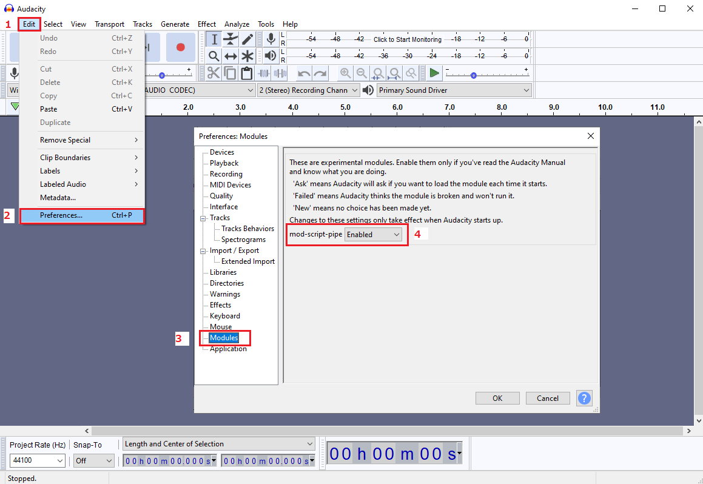
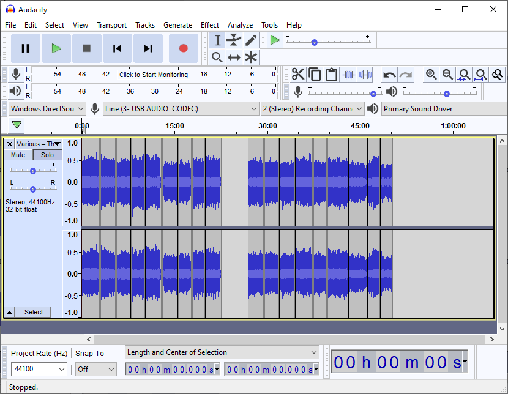

# Vinyl2Digital 🎵

[](https://pypi.org/project/vinyl2digital)   

**Vinyl2Digital** is a Python3 pip package for batch rendering multiple audio files using the [Audacity](https://www.audacityteam.org/download/) mod-script-pipe. Perfect for digitizing vinyl records, cassettes, or any multi-track audio recordings.

## 🚀 Quick Start

```bash
# Install
pip install vinyl2digital

# Update
pip install --upgrade vinyl2digital

# Test connection
python -m vinyl2digital -t
```

## 📋 Table of Contents

- [Installation](#installation)
- [Setup](#setup)
- [Usage](#usage)
- [Command Line Flags](#command-line-flags)
- [Examples](#examples)
- [Development](#development)
- [Releasing New Versions](#releasing-new-versions)

## 📦 Installation

```bash
pip install vinyl2digital
```

## ⚙️ Setup

### 1. Enable mod-script-pipe in Audacity



### 2. Launch Audacity from Terminal

**Windows (Command Prompt Admin):**
```cmd
cd "C:\Program Files\Audacity"
start audacity.exe
```

**macOS/Linux:**
```bash
open -a Audacity
# or
audacity
```

### 3. Prepare Your Audio

1. **Record your audio** and splice each track into its own selection
2. **Place cursor** at the start of each track and press `Ctrl+I` (or `Cmd+I` on Mac)
3. **Set export quality** by going to `File → Export → Export Selected Audio` - these settings will be used by vinyl2digital
4. **Move cursor** to the start of your recording



### 4. Test Connection

While Audacity is open, test your connection:

```bash
python -m vinyl2digital -t
```

You should see confirmation that both pipes exist and are working.

## 🎯 Usage

### Basic Command Structure

```bash
python -m vinyl2digital -i [input] -f [format] -o [output_path]
```

### Export with Discogs Metadata

```bash
python -m vinyl2digital -i discogs [discogs_url] -f flac -o "path/to/output"
```

### Export with Custom Track Count

```bash
python -m vinyl2digital -i 12 -f mp3 -o "path/to/output"
```

## 🚩 Command Line Flags

### Help & Testing
| Flag | Description |
|------|-------------|
| `-h` | View help page |
| `-t` | Test connection to Audacity mod-script-pipe |

### Input
| Flag | Description |
|------|-------------|
| `-i discogs [url]` | Use Discogs URL for track count and metadata |
| `-i [number]` | Export specified number of tracks with default filenames |

### Output Format
| Flag | Description |
|------|-------------|
| `-f flac` | Export as FLAC audio files |
| `-f mp3` | Export as MP3 audio files |
| `-f wav` | Export as WAV audio files |

### Output Location
| Flag | Description |
|------|-------------|
| `-o "path"` | Set output directory path |

## 💡 Examples

### Export Tracks with Discogs Metadata

```bash
python -m vinyl2digital -i discogs https://www.discogs.com/release/2019460-Various-The-New-England-Teen-Scene -f flac -o "E:\rips\vinyl\NewEnglandTeenScene"
```

### Export Custom Number of Tracks

```bash
python -m vinyl2digital -i 5 -f mp3 -o "E:\rips\vinyl\MyAlbum"
```

### Complex Output Path (Windows)

```bash
python -m vinyl2digital -i 7 -f flac -o "E:\martinradio\rips\cassette\Art Foxall – Art's Back In Town [1987, Cassette]"
```

## 🛠️ Development

### Local Development Setup

#### 1. Clone the Repository
```bash
git clone https://github.com/MartinBarker/vinyl2digital.git
cd vinyl2digital
```

#### 2. Create and Activate Virtual Environment

**Create Virtual Environment:**
```bash
# Create a new virtual environment
python -m venv venv
```

**Activate Virtual Environment:**

**Windows (Command Prompt):**
```cmd
venv\Scripts\activate
```

**Windows (PowerShell):**
```powershell
venv\Scripts\Activate.ps1
```

**macOS/Linux:**
```bash
source venv/bin/activate
```

**Note:** You'll know the virtual environment is active when you see `(venv)` at the beginning of your command prompt.

#### 3. Install Package in Development Mode
```bash
# Install the package in editable mode for local development
pip install -e .

# This allows you to modify the code and see changes immediately
# without reinstalling the package
```

#### 4. Verify Installation and View Package Info
```bash
# Check if the package is installed
pip list | grep vinyl2digital

# View package information including version
pip show vinyl2digital

# Run the package to see help
python -m vinyl2digital -h

# Test the package functionality
python -m vinyl2digital -t
```

#### 5. Deactivate Virtual Environment (when done)
```bash
deactivate
```

### Required Dependencies
- `os`, `sys`, `requests`, `json`, `time`, `re`

## 🚀 Releasing New Versions

This project uses GitHub Actions for automated building and publishing to PyPI. Here's how to release a new version:

### 1. Update Version Number

Edit `setup.py` and increment the version number:

```python
setup(
    name="vinyl2digital",
    version="1.0.7",  # ← Update this
    # ... rest of setup
)
```

### 2. Commit and Tag

```bash
# Commit your changes
git add .
git commit -m "Bump version to 1.0.7"

# Create and push a new tag
git tag v1.0.7
git push origin main --tags
```

### 3. Automated Release Process

The GitHub Actions workflow will automatically:

1. **Build** the distribution packages (wheel and source tarball)
2. **Publish to TestPyPI** on every push (for testing)
3. **Publish to PyPI** when you push a tag (for releases)

### 4. Monitor the Release

- Check the [Actions tab](https://github.com/MartinBarker/vinyl2digital/actions) in your GitHub repository
- Verify the workflow completed successfully
- Check [PyPI](https://pypi.org/project/vinyl2digital/) for your new version

### Manual Release (Alternative)

If you prefer to release manually:

```bash
# Build the package
python -m pip install --upgrade build
python -m build

# Upload to PyPI
pip install twine
python -m twine upload dist/*
```

## 📁 Project Structure

```
vinyl2digital/
├── .github/
│   └── workflows/
│       └── publish-to-pypi.yml    # GitHub Actions workflow
├── vinyl2digital/
│   ├── __init__.py                 # Main package code
│   └── __main__.py                 # Entry point
├── setup.py                        # Package configuration
├── README.md                       # This file
└── LICENSE                         # License information
```

## 🔧 Troubleshooting

### Common Issues

1. **"Both pipes exist. Good."** - Connection is working correctly
2. **"..does not exist. Ensure Audacity is running with mod-script-pipe"** - Enable mod-script-pipe in Audacity
3. **Files not appearing in expected location** - Check the detailed output logs for exact file paths

### Getting Help

- Check the [PyPI project page](https://pypi.org/project/vinyl2digital/)
- Review the command line help: `python -m vinyl2digital -h`
- Ensure Audacity is running with mod-script-pipe enabled

## 📄 License

This project is licensed under the MIT License - see the [LICENSE](LICENSE) file for details.

## 🤝 Contributing

Contributions are welcome! Please feel free to submit a Pull Request.

---

**Made with ❤️ for the vinyl digitization community**
